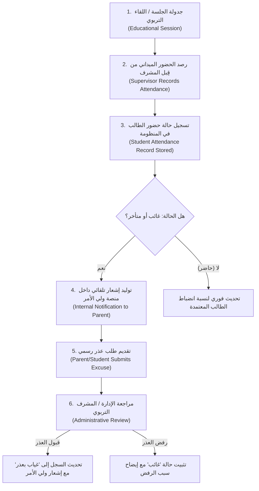

# وثيقة التصميم التقني — المرحلة 2.3: منظومة الحضور والتقييم التعليمي والقيمي
## Technical Design Document — Phase 2.3: Attendance & Educational Evaluation
**المشروع:** مؤسسة مِشكاة التربوية والتعليمية  
**الحالة:** مُقترح تقني بانتظار الاعتماد المؤسسي (PROPOSED — PENDING INSTITUTIONAL APPROVAL)  
**التاريخ:** 2026-09-25  
**الإصدار:** 1.0.0 (مسودة هندسية أولية للتخطيط فقط — لا تتضمن كود تنفيذي)

---

> [!IMPORTANT]
> **تنبيه نظامي وتوجيه أساسي:**
> هذه الوثيقة تمثل **تصميمًا معماريًا وتقنيًا مقترحًا فقط** تمهيدًا للمرحلة 2.3، ولا تتضمن أي كود تنفيذي أو قواعد عمل نهائية. **جميع السياسات وقواعد الدرجات والغياب مصنفة كـ "مقترح بانتظار الاعتماد المؤسسي"**، ولن يتم الشروع في البرمجة حتى صدور القرارات المؤسسية الرسمية المعتمدة من مجلس إدارة المؤسسة ولجانها التربوية.

---

## 1. منظومة الحضور والانضباط (Attendance Architecture)

### 1.1 حالات الحضور المقترحة (Proposed Attendance Statuses)
*(مُقترح — بانتظار الاعتماد المؤسسي الرسمي)*

| الحالة المقترحة | الوصف التقني المقترح | الأثر على الالتزام | قابلية طلب العذر |
| :--- | :--- | :---: | :---: |
| **حاضر** | حضور الطالب في موعد اللقاء المعتمد | إيجابي (100%) | لا ينطبق |
| **متأخر** | حضور الطالب بعد بدء اللقاء بوقت محدد | احتساب جزئي (يُحدد لاحقًا) | متاح في حال وجود سبب طارئ |
| **مستأذن** | خروج مبكر أو استئذان مسبق معتمد | معفى من الحسم | يلزم إشعار/طلب مسبق |
| **غياب بعذر** | عدم حضور الطالب مع تقديم عذر رسمي وقبوله | معفى من الإنذار الإداري | يتطلب اعتماد المشرف/الإدارة |
| **غائب** | تخلف الطالب عن الحضور دون إشعار أو عذر مقبول | احتساب غياب كامل | يمكن تحويله إلى غياب بعذر خلال مهلة نظامية |

> [!NOTE]
> لا تُعتبر هذه الحالات ولا نسب الحسم سياسة رسمية حتى يتم اعتمادها رسميًا من إدارة المؤسسة.

---

### 1.2 دورة عمل الحضور والغياب المقترحة (Proposed Attendance Workflow)



#### مراحل دورة العمل:
1. **جدولة الجلسة (`Session Scheduling`):** إنشاء اللقاء (التاريخ، التوقيت، المسار التعليمي، المشرف، والموقع/القاعة).
2. **الرصد المباشر (`Live Attendance Recording`):** قيام المشرف المعتمد برصد الحالات دفعة واحدة عبر واجهة رقمية متجاوبة وسريعة.
3. **التوثيق الآني وحساب الانضباط (`Real-time Logging`):** تسجيل المعرف الزمني، والمشرف الراصد، وربط السجل بالطالب والجلسة.
4. **التنبيه الداخلي لولي الأمر (`Platform Notification`):** إرسال تنبيه في صندوق إشعارات المنصة لولي الأمر عند تسجيل غياب أو تأخر بدون استخدام SMS/WhatsApp في هذه المرحلة.
5. **تقديم العذر (`Excuse Request Submission`):** إتاحة تقديم العذر من ولي الأمر أو الطالب مع تحديد النوع (مرضي، عائلي، مدرسي) ومرفق توضيحي إن وجد.
6. **الاعتماد الإداري (`Administrative Approval`):** قرار الإدارة بالاعتماد وتعديل الأثر على السجل الأكاديمي للطالب.

---

## 2. الإطار المعماري للتقييم التعليمي والقيمي (Evaluation Framework)

### 2.1 محاور البناء الخمسة في مؤسسة مِشكاة
صُممت بنية التقييم لتدعم المحاور الخمسة المعتمدة للمؤسسة:
1. **العلوم الشرعية:** التأصيل الشرعي الرصين، التدبر، والتطبيقات القيمية المعاصرة.
2. **العلوم والمعارف:** مهارات التفكير الناقد، القراءة المستوعبة، والبحث العلمي والوعي الرقمي.
3. **بناء الشخصية والقيم:** الانضباط الذاتي، إدارة الأولويات، وتحمل المسؤولية المجتمعية.
4. **القيادة وصناعة الأثر:** المبادرة الميدانية، فنون الحوار والتأثير، والعمل الجماعي.
5. **الأنشطة والمبادرات:** الواجبات الميدانية، المشاريع التطوعية، والورش التفاعلية.

---

### 2.2 بنية مرنة ثنائية النمط (Dual-Mode Flexible Evaluation Architecture)
*(مُقترح — بانتظار تحديد المنهجية المؤسسية الرسمية)*

صُممت المنظومة لتكون قابلة للتشغيل بأحد النمطين، أو بدمجهما معًا (Hybrid)، دون الحاجة لإعادة كتابة الكود:

```
                  ┌────────────────────────────────────────┐
                  │    بنية التقييم المرنة في مِشكاة       │
                  └──────────────────┬─────────────────────┘
                                     │
         ┌───────────────────────────┴───────────────────────────┐
         ▼                                                       ▼
┌─────────────────────────────────┐             ┌─────────────────────────────────┐
│     النمط الأول: التقييم النوعي │             │     النمط الثاني: التقييم الرقمي│
│        (Qualitative Mode)       │             │         (Numerical Mode)        │
├─────────────────────────────────┤             ├─────────────────────────────────┤
│ • ممتاز (Excellent)             │             │ • درجات عددية (مثلاً: من 100)   │
│ • جيد جدًا (Very Good)          │             │ • أوزان نسبية لكل محور (Weights)│
│ • جيد (Good)                    │             │ • نسب مئوية ومعدلات تراكمية     │
│ • يحتاج متابعة (Needs Follow-up)│             │ • معدل عام للفصل الدراسي        │
│ • ملاحظات وصفية نوعية للمشرف    │             │ • درجات الواجبات والاختبارات    │
└─────────────────────────────────┘             └─────────────────────────────────┘
```

#### المتطلبات التقنية للمرونة:
- جدول `evaluation_dimensions` يخزن إمكانية التقييم النوعي والرقمي لكل محور.
- جدول `evaluations` يحتوي على حقلي `qualitative_rating` و `numerical_score` بالتوازي، بحيث يتم تفعيل أحدهما أو كليهما طبقاً لقرار المؤسسة.
- عدم كتابة أي أوزان أو قواعد حسابية ثابتة (Hard-coded rules) قبل اعتمادها المؤسسي.

---

## 3. تصميم نموذج البيانات وجداول قاعدة البيانات (Proposed Data Model)
*(هجرة آمنة وتراكمية بالكامل — Safe Additive Migration — لا تعديل ولا حذف في الجداول السابقة)*

```sql
-- ========================================================
-- PHASE 2.3 PROPOSED SCHEMA — PENDING INSTITUTIONAL APPROVAL
-- ========================================================

-- 1. الفترات والسنوات الأكاديمية (Evaluation & Academic Periods)
CREATE TABLE IF NOT EXISTS evaluation_periods (
    id TEXT PRIMARY KEY,
    academic_year TEXT NOT NULL,         -- e.g. '2026-2027'
    period_name TEXT NOT NULL,           -- e.g. 'الفصل الدراسي الأول', 'الربع الأول'
    start_date TEXT NOT NULL,
    end_date TEXT NOT NULL,
    status TEXT NOT NULL DEFAULT 'active', -- 'active', 'closed', 'upcoming'
    created_at DATETIME DEFAULT CURRENT_TIMESTAMP
);

-- 2. أبعاد ومحاور التقييم القابلة للتخصيص (Evaluation Dimensions & Configuration)
CREATE TABLE IF NOT EXISTS evaluation_dimensions (
    id TEXT PRIMARY KEY,
    dimension_name TEXT NOT NULL,        -- 'العلوم الشرعية', 'العلوم والمعارف', ...
    evaluation_mode TEXT DEFAULT 'hybrid', -- 'qualitative', 'numerical', 'hybrid'
    weight REAL DEFAULT 20.0,            -- الوزن النسبي المئوي
    max_score REAL DEFAULT 100.0,        -- الدرجة القصوى في حال النمط الرقمي
    qualitative_scale TEXT,              -- JSON array: ['ممتاز', 'جيد جدًا', 'جيد', 'يحتاج متابعة']
    status TEXT NOT NULL DEFAULT 'active',
    sort_order INTEGER DEFAULT 0,
    created_at DATETIME DEFAULT CURRENT_TIMESTAMP
);

-- 3. الجلسات واللقاءات التعليمية (Educational Sessions)
CREATE TABLE IF NOT EXISTS sessions (
    id TEXT PRIMARY KEY,
    program_id TEXT,                     -- مرتبط بمسار تعليمي
    title TEXT NOT NULL,                 -- عنوان اللقاء / الورشة
    session_date TEXT NOT NULL,          -- YYYY-MM-DD
    start_time TEXT,                     -- HH:MM
    end_time TEXT,                       -- HH:MM
    supervisor_id TEXT,                  -- المشرف المسؤول (users.id)
    location TEXT,                       -- القاعة أو رابط اللقاء
    status TEXT NOT NULL DEFAULT 'scheduled', -- 'scheduled', 'completed', 'cancelled'
    created_at DATETIME DEFAULT CURRENT_TIMESTAMP,
    FOREIGN KEY (program_id) REFERENCES programs(id) ON DELETE SET NULL,
    FOREIGN KEY (supervisor_id) REFERENCES users(id) ON DELETE SET NULL
);

-- 4. سجل الحضور والانضباط اليومي (Attendance Records)
CREATE TABLE IF NOT EXISTS attendance (
    id TEXT PRIMARY KEY,
    session_id TEXT NOT NULL,
    student_id TEXT NOT NULL,
    status TEXT NOT NULL,                -- 'حاضر', 'غائب', 'متأخر', 'مستأذن', 'غياب بعذر'
    recorded_by TEXT NOT NULL,           -- المعرف الذي قام بالرصد
    recorded_at DATETIME DEFAULT CURRENT_TIMESTAMP,
    notes TEXT,                          -- ملاحظة المشرف أثناء الرصد
    excuse_id TEXT,                      -- رابط العذر المعتمد إن وجد
    created_at DATETIME DEFAULT CURRENT_TIMESTAMP,
    updated_at DATETIME DEFAULT CURRENT_TIMESTAMP,
    FOREIGN KEY (session_id) REFERENCES sessions(id) ON DELETE CASCADE,
    FOREIGN KEY (student_id) REFERENCES students(id) ON DELETE CASCADE,
    FOREIGN KEY (recorded_by) REFERENCES users(id) ON DELETE RESTRICT
);

-- 5. طلبات الأعذار والاستئذان الرسمية (Attendance Excuses)
CREATE TABLE IF NOT EXISTS attendance_excuses (
    id TEXT PRIMARY KEY,
    student_id TEXT NOT NULL,
    session_id TEXT,                     -- الجلسة المرتبطة (إن حددت)
    excuse_date TEXT NOT NULL,           -- تاريخ الغياب/الاستئذان
    submitted_by_user_id TEXT NOT NULL,  -- معرف ولي الأمر أو الطالب مقدم الطلب
    submitted_by_role TEXT NOT NULL,     -- 'parent', 'student'
    excuse_type TEXT NOT NULL,           -- 'صحي', 'طارئ أسري', 'ارتباط مدرسي', 'أخرى'
    reason TEXT NOT NULL,                -- شرح العذر
    document_url TEXT,                   -- رابط التقرير الطبي أو المستند المؤيد
    review_status TEXT NOT NULL DEFAULT 'pending', -- 'pending', 'approved', 'rejected'
    reviewed_by TEXT,                    -- المشرف/الإداري المراجع
    reviewer_notes TEXT,                 -- سبب القبول أو الرفض
    reviewed_at DATETIME,
    created_at DATETIME DEFAULT CURRENT_TIMESTAMP,
    FOREIGN KEY (student_id) REFERENCES students(id) ON DELETE CASCADE,
    FOREIGN KEY (session_id) REFERENCES sessions(id) ON DELETE SET NULL,
    FOREIGN KEY (submitted_by_user_id) REFERENCES users(id) ON DELETE CASCADE,
    FOREIGN KEY (reviewed_by) REFERENCES users(id) ON DELETE SET NULL
);

-- 6. سجل التقييمات التربوية (Student Evaluations)
CREATE TABLE IF NOT EXISTS evaluations (
    id TEXT PRIMARY KEY,
    period_id TEXT NOT NULL,
    student_id TEXT NOT NULL,
    dimension_id TEXT NOT NULL,
    qualitative_rating TEXT,             -- 'ممتاز', 'جيد جدًا', 'جيد', 'يحتاج متابعة'
    numerical_score REAL,                -- الدرجة في حال النمط الرقمي
    supervisor_notes TEXT,               -- التوجيه والملاحظات التربوية النوعية
    evaluated_by TEXT NOT NULL,          -- المشرف الراصد
    evaluation_status TEXT NOT NULL DEFAULT 'draft', -- 'draft', 'submitted', 'approved', 'published'
    published_at DATETIME,
    created_at DATETIME DEFAULT CURRENT_TIMESTAMP,
    updated_at DATETIME DEFAULT CURRENT_TIMESTAMP,
    FOREIGN KEY (period_id) REFERENCES evaluation_periods(id) ON DELETE RESTRICT,
    FOREIGN KEY (student_id) REFERENCES students(id) ON DELETE CASCADE,
    FOREIGN KEY (dimension_id) REFERENCES evaluation_dimensions(id) ON DELETE RESTRICT,
    FOREIGN KEY (evaluated_by) REFERENCES users(id) ON DELETE RESTRICT
);

-- 7. منظومة الإشعارات الداخلية (Internal Platform Notifications)
CREATE TABLE IF NOT EXISTS notifications (
    id TEXT PRIMARY KEY,
    recipient_user_id TEXT NOT NULL,
    recipient_role TEXT NOT NULL,        -- 'parent', 'student', 'admin', 'supervisor'
    title TEXT NOT NULL,
    message TEXT NOT NULL,
    notification_type TEXT NOT NULL,     -- 'absence', 'late', 'excuse_status', 'observation', 'evaluation'
    reference_entity_type TEXT,          -- 'attendance', 'attendance_excuses', 'evaluations'
    reference_entity_id TEXT,
    is_read INTEGER DEFAULT 0,
    read_at DATETIME,
    created_at DATETIME DEFAULT CURRENT_TIMESTAMP,
    FOREIGN KEY (recipient_user_id) REFERENCES users(id) ON DELETE CASCADE
);

-- الفهارس التراكمية لتحسين أداء الاستعلامات وعزل المعرفات
CREATE INDEX IF NOT EXISTS idx_attendance_student ON attendance(student_id);
CREATE INDEX IF NOT EXISTS idx_attendance_session ON attendance(session_id);
CREATE INDEX IF NOT EXISTS idx_evaluations_student ON evaluations(student_id);
CREATE INDEX IF NOT EXISTS idx_evaluations_period ON evaluations(period_id);
CREATE INDEX IF NOT EXISTS idx_notifications_recipient ON notifications(recipient_user_id, is_read);
```

---

## 4. بنية واجهات البرمجة المقترحة (Proposed API Structure)
*(مُقترح — بانتظار الاعتماد المؤسسي)*

### أ. واجهات الحضور والانضباط (`/api/attendance/*`):
- `GET /api/attendance/sessions`: استعراض الجلسات المجدولة بحسب التاريخ والمسار التعليمي (للمشرفين والإدارة).
- `POST /api/attendance/sessions`: إنشاء جلسة تعليمية جديدة مجدولة (للإدارة والمشرفين).
- `GET /api/attendance/sessions/:id`: تفاصيل الجلسة وقائمة حضورها.
- `POST /api/attendance/sessions/:id/records`: رصد حضور وغياب الطلاب في الجلسة المحددة دفعة واحدة.
- `GET /api/attendance/student/:studentId`: استعلام سجل حضور الطالب (محمي بضوابط IDOR للطالب أو ولي أمره).
- `POST /api/attendance/excuses`: تقديم طلب استئذان أو عذر غياب (متاح للطالب أو ولي أمره).
- `GET /api/attendance/excuses`: استعراض طلبات الأعذار (مفلترة بحسب هوية مقدم الطلب، أو للإدارة كاملة).
- `PATCH /api/attendance/excuses/:id/review`: مراجعة وقبول/رفض العذر (محصورة بالإدارة والمشرف المعتمد).

### ب. واجهات التقييم التعليمي والقيمي (`/api/evaluations/*`):
- `GET /api/evaluations/periods`: استعراض الفترات الأكاديمية النشطة.
- `GET /api/evaluations/dimensions`: استعراض محاور التقييم ومعاييرها.
- `GET /api/evaluations/student/:studentId`: استعراض تقييمات الطالب المعتمدة والمنشورة (محمي بـ IDOR).
- `POST /api/evaluations/student/:studentId`: رصد تقييم جديد كمسودة (مسند للمشرف التربوي).
- `PATCH /api/evaluations/:id`: تعديل تقييم قيد المراجعة.
- `POST /api/evaluations/periods/:periodId/publish`: اعتماد ونشر تقييمات الفترة رسميًا لتظهر للطلاب وأولياء الأمور.

### ج. واجهات الإشعارات الداخلية (`/api/notifications/*`):
- `GET /api/notifications`: جلب الإشعارات الخاصة بالمستخدم المسجل مع عداد غير المقروء.
- `PATCH /api/notifications/:id/read`: تحديد إشعار كمقروء.
- `POST /api/notifications/mark-all-read`: تحديد كافة الإشعارات كمقروءة.

---

## 5. مصفوفة الصلاحيات الموسعة (Role-Based Access Control - Extended Matrix)

| الوظيفة / الإجراء | الطالب (`STUDENT`) | ولي الأمر (`PARENT`) | المشرف/المعلم (`SUPERVISOR`) | مدير النظام (`ADMIN`) |
| :--- | :---: | :---: | :---: | :---: |
| استعراض حضور الجلسة | سجله الشخصي فقط | أبناؤه المرتبطون فقط | طلاب مساراته المسندة | كافة الطلاب والجلسات |
| رصد وتعديل الحضور | ❌ ممنوع | ❌ ممنوع | ✅ للطلاب المسندين إليه | ✅ صلاحية شاملة |
| تقديم طلب عذر غياب | ✅ لنفسه | ✅ لأبنائه المرتبطين | ❌ لا ينطبق | ✅ بالنيابة بتفويض |
| مراجعة وقبول الأعذار | ❌ ممنوع | ❌ ممنوع | ✅ بتفويض إداري | ✅ صلاحية كاملة |
| استعراض التقييمات المنشورة | تقييماته الشخصية فقط | تقييمات أبنائه فقط | تقييمات طلابه | كافة التقييمات |
| رصد مسودة التقييم | ❌ ممنوع | ❌ ممنوع | ✅ لطلابه المسندين | ✅ صلاحية كاملة |
| اعتماد ونشر التقييمات | ❌ ممنوع | ❌ ممنوع | ❌ ممنوع | ✅ الإدارة حصريًا |
| إدارة الفترات والمحاور والأوزان | ❌ ممنوع | ❌ ممنوع | ❌ ممنوع | ✅ الإدارة حصريًا |

> **ملاحظة أمنية أساسية:** تبقى أدوار `ADMIN` و `STUDENT` و `PARENT` الحالية مستقرة وآمنة بنسبة 100% دون أي تعديل في صلاحياتها الحالية.

---

## 6. متطلبات الخصوصية وحماية البيانات الحساسة (Privacy & Minor Protection)

1. **الخصوصية التامة لبيانات القُصّر:**
   - الحضور والغياب والتقييمات التربوية تُعتبر بيانات تعليمية وشخصية حساسة.
   - لا تتاح أي واجهة استعلام عامة غير موثقة (No Public APIs for Attendance or Evaluations).
2. **منع ثغرات المعرف المباشر (Anti-IDOR):**
   - التحقق الصارم في طبقة الـ Middleware من أن الطالب لا يستعرض إلا سجلاته، وأن ولي الأمر لا يستعرض إلا الطلاب المرتبطين به في `parent_student`.
3. **عزل ملاحظات التقييم الداخلية:**
   - فصل ملاحظات المشرفين التوجيهية المنشورة عن محاضر وتوصيات اللجان الإدارية الخاصة.

---

## 7. القرارات المؤسسية المطلوبة قبل بدء التنفيذ البرمجي
*(Required Institutional Decisions)*

لضمان بناء المنظومة بدقة مطابقة للواقع الميداني، يُطلب من إدارة المؤسسة تزويدنا بالقرارات الآتية:

1. **اعتماد حالات الحضور ونسب الحسم:**
   - هل تعتمد المؤسسة الحالات الخمس المقترحة؟
   - ما هي المهلة الزمنية المسموحة لتقديم عذر الغياب (مثلاً: خلال 48 ساعة أو أسبوع)؟
2. **منهجية التقييم في المحاور الخمسة:**
   - هل ترغب المؤسسة في:
     - أ) تقييم وصفي نوعي فقط (ممتاز، جيد جدًا، جيد، يحتاج متابعة)؟
     - ب) تقييم رقمي بدرجات وأوزان مئوية لكل محور؟
     - ج) نمط هجين (درجة عددية مصحوبة بتقدير وصفي وملاحظات نوعية)؟
3. **أوزان المحاور الخمسة:**
   - في حال اختيار التقييم الرقمي أو الهجين، ما هو الوزن المئوي لكل محور من المحاور الخمسة؟
4. **سياسة الإنذارات والتنبيهات:**
   - ما هو حد الغياب الذي يستوجب توجيه إشعار تنبيه أول/ثانٍ لولي الأمر؟
5. **الفترات الأكاديمية المعتمدة:**
   - تحديد مواعيد بداية ونهاية الفصول الدراسية للعام الحالي 2026-2027.

---

## 8. خارطة الطريق التقنية والالتزام بالترتيب (Roadmap Alignment)

```
[V1] البوابة العامة ونظام التقديم والتسجيل (مكتمل ومستقر)
  ↓
[Phase 2.1] بوابة الطالب ومنظومة الحسابات المعتمدة (مكتمل ومستقر)
  ↓
[Phase 2.2] بوابة أولياء الأمور وإدارة العلاقات والأبناء (مكتمل ومستقر ومتحقق منه)
  ↓
[Phase 2.3] الحضور والانضباط والتقييم التعليمي والقيمي (قيد التجهيز والتصميم التقني)
  ↓
[Phase 2.4] الشهادات الرقمية الموثقة والتحقق الإلكتروني بالـ QR (المرحلة اللاحقة)
```

> [!NOTE]
> **التزام صريح بعدم دمج الشهادات:** إصدار الشهادات الرقمية المعتمدة يظل حصريًا في المرحلة 2.4 ولا يتم دمجه في المرحلة 2.3.

---

## 9. شرط التوقف والجاهزية (Stop Condition)
تم الانتهاء من إعداد هذا التصميم المعماري ونموذج البيانات والواجهات المقترحة بالكامل. **يتوقف العمل البرمجي والتنفيذي عند هذه النقطة تمامًا**، بانتظار القرارات المؤسسية الرسمية والموافقة الصريحة للبدء في المرحلة 2.3.
